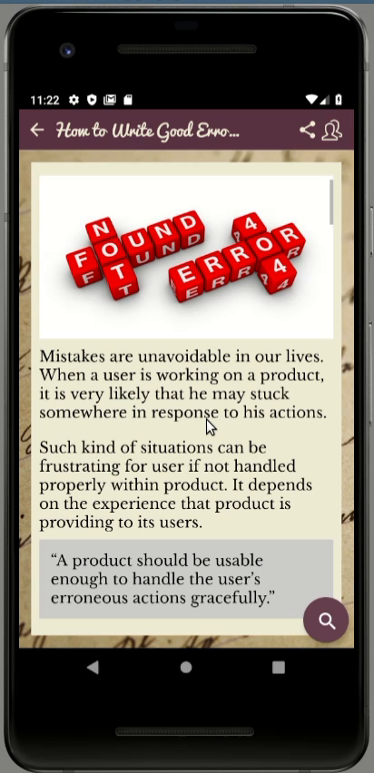
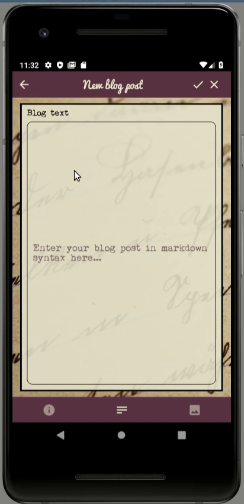

# YouBlog

YouBlog is a mobile blogging app written with React Native and Expo. It lets you browse a list of
posts, read them rendered from Markdown, sign up and log in, write, edit and delete your own posts,
attach a cover image taken with the camera or picked from the gallery, and share a post by a link
that opens the app on the right screen. The backend is Firebase: Firestore for the posts, Firebase
Auth for accounts, Cloud Storage for the images.

It was the final project of Toptal's React Native Academy 2020, a program Toptal ran to qualify
existing talent for React Native work. The task was assigned on 2020-04-22 with a three-week
deadline; this repository, plus a demo screencast, was the submission of 2020-05-15. It passed on
2020-05-22, and Toptal's screener rated it the best submission they had seen up to that point.

The code is from 2020 and is kept as it was submitted. See [Running it today](#running-it-today)
before you try to start it.

## Screenshots

The post list, a post with its cover image, and the editor for a new post.

## What it does

* Read: a list of all posts, each post rendered from Markdown, with a cover image and a zoom control
  for the text size
* Accounts: sign up, log in, log out, with the login restored on the next start
* Write: create, edit and delete your own posts; the three tabs of the editor cover title and author,
  the Markdown text, and the image
* Images: take a photo or pick one from the gallery, crop it, upload it to Cloud Storage
* Share: a post can be shared as a deep link or an HTTPS link that opens the app on that post
* One theme carried through the whole app, paper background with typewriter and handwriting fonts,
  plus an app-wide error boundary and its own loading and error screens

## Built with

TypeScript 3.8, React Native through Expo SDK 37, React Navigation 5, Redux with thunks and immer,
React Native Paper and React Native Elements for the UI, `react-native-markdown-display` for the
rendering, Firebase for the backend, and Jest for the unit tests of the toolbelt modules. The
smaller helpers are axios for the networking, chroma-js for the colours, moment for the dates and
validate.js for the forms; ts-node and ts-node-dev run the local scripts, and prettier formats.

The whole app is TypeScript under `strict`, although the course itself taught JavaScript. Three of
the libraries shipped no types, so the repository carries its own shims for them in
`src/@types/`.

## How it is put together

    App.tsx        navigation stack, theme provider, store provider, deep-link configuration
    screens/       the screens and the forms of the editor
    components/    the reusable parts: error boundary, Markdown renderer, theming, headers
    store/         Redux reducers and actions for auth, blog and settings
    model/         the domain layer: blog entries, authentication, sharing
    src/           the toolbelt: Firestore, Auth, Storage, networking, images, with unit tests
    config/        theming and logging
    data/          seed posts, the upload scripts and the Firestore security rules

Firestore is driven through its ReST API rather than through the Firebase SDK, after the SDK proved
unreliable mid-project. `src/FirestoreTools.ts` does the mapping between Firestore's typed field
representation and plain JavaScript values, and `model/Blog.ts` keeps both implementations side by
side and picks one, so the backend stays swappable.

`TODO.md` is the original working list and still names what was left undone at the deadline,
end-to-end tests among them.

## Running it today

The demo Firebase project is dormant. It still answers reads, but Cloud Storage is unlinked, so the
post images return 404, and account creation is disabled, so nothing can be written. The app is
therefore not something to point at that backend and use; treat this repository as a code sample.
The dependencies are pinned to Expo SDK 37 and to the tooling of 2020, and are not maintained.

`firebaseConfig.json` is in the repository on purpose. A Firebase web config is meant to ship inside
the client and is not a secret; what protects the project are the security rules, which are in
`data/firebase.rules`: public read on the posts, writing only for authenticated users, changing or
deleting only for the author of a post.
